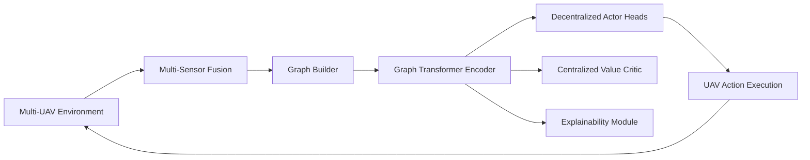
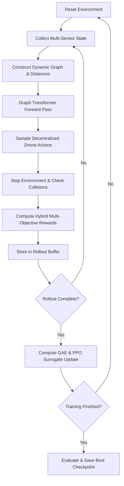

# Graph Transformer Multi-Agent Reinforcement Learning for UAV Navigation


A multi-agent reinforcement learning (MARL) framework for cooperative unmanned aerial vehicle (UAV) navigation in dynamic 3D environments. Drones, obstacles, and targets are modeled as a dynamic spatial graph processed by a **Graph Transformer with Continuous Distance-Biased Soft Masking**. A Centralized Training with Decentralized Execution (CTDE / MAPPO) policy controls multi-drone navigation while exposing multi-head attention weights for interpretability and post-hoc decision explainability.

---

## Table of Contents

1. [Overview](#1-overview)
2. [Key Architecture Components](#2-key-architecture-components)
3. [Workflow](#3-workflow)
4. [Technology Stack](#4-technology-stack)
5. [Directory Structure](#5-directory-structure)
6. [Installation](#6-installation)
7. [Usage & Training](#7-usage--training)
8. [Evaluation & Baseline Comparison](#8-evaluation--baseline-comparison)
9. [Explainability & Attention Visualization](#9-explainability--attention-visualization)
10. [Benchmark Metrics](#10-benchmark-metrics)
11. [Testing](#11-testing)

---

## 1. Overview

Autonomous multi-UAV navigation in congested or obstacle-rich 3D airspaces presents significant coordination and safety challenges. Traditional methods using flattened vectors (MLP) or fixed-resolution grids (CNN) do not scale seamlessly to varying fleet sizes and dynamic obstacle counts.

This framework solves these challenges through:
- **Dynamic Graph Representation**: Variable numbers of drones, obstacles, and targets are encoded as nodes in a unified spatial graph.
- **Relational Reasoning via Graph Transformer**: Nodes communicate via multi-head self-attention with continuous logarithmic distance biases ($-|\gamma| \cdot \log(1 + d_{ij})$), preventing node isolation while prioritizing local interactions.
- **CTDE (MAPPO) Policy**: Decentralized actor heads execute actions per drone from individual node embeddings, while a centralized value critic evaluates global team states.
- **Intrinsic Explainability**: Multi-layer attention weights are exposed to rank top influential neighbors (drones/obstacles) guiding each maneuver.
- **Teacher → DAgger → RL Pipeline**: The policy first imitates an obstacle-aware look-ahead planner (`bc_pretrain.py`), is corrected with DAgger on the states it actually visits, then is RL fine-tuned. Pure RL from scratch never left 0% success on this task; see [§7](#7-usage--training).

---

## 2. Key Architecture Components



### Module Breakdown
- **`airsim_interface`**: Fast surrogate 3D physics environment with boundary constraints, obstacle collision checking, battery dynamics, and Microsoft AirSim compatibility.
- **`state_processing`**: Builds normalized 16-dimensional node features (position, velocity, battery, target vector) and pairwise Euclidean distance matrices. With `model.obstacle_sensor = true`, each drone also gets a nearest-obstacle proximity vector (direction × closeness within `sensor_range`), a one-beam LiDAR summary.
- **`graph_transformer`**: Custom pure PyTorch Graph Transformer featuring learnable per-head distance penalty scaling ($\gamma$) and multi-head attention extraction.
- **`rl_engine`**: Multi-Agent PPO (MAPPO) with per-agent Generalized Advantage Estimation (GAE), clipped surrogate + value-clipped objective, entropy regularization, and multi-objective reward assignment. Action space is 8 discrete actions (hover, ±X, ±Y, ±Z, plus a dynamic brake that exactly zeroes current velocity in one step).
- **`explainability`**: Attention rollout extraction, multi-layer attention heatmaps, and top-$K$ influential entity ranking per drone.
- **`evaluation`**: End-to-end evaluation suite benchmarking against MLP and CNN baseline policies across 7 core flight metrics.

---

## 3. Workflow



---

## 4. Technology Stack

| Layer | Technology | Role |
|---|---|---|
| Runtime | Python 3.11+ | Core programming environment |
| Package Management | `uv` | High-performance virtual environment & dependency management |
| Deep Learning | PyTorch $\ge 2.2$ | Neural network architectures, autograd, and GPU acceleration |
| RL Algorithm | Custom MAPPO (CTDE) | Multi-agent on-policy actor-critic with GAE |
| Graph Attention | Custom Graph Transformer | Dense self-attention with continuous distance bias |
| Simulation | Fast 3D Surrogate + AirSim Backend | Rapid RL training with optional photorealistic validation |
| Visualization & Tracking | Matplotlib, TensorBoard, React + Vite, three.js | Metric logging, loss curves, attention heatmaps, interactive 2D/3D replay viewer |
| Testing | `pytest` | Unit and integration test suite |

---

## 5. Directory Structure

```
.
├── configs/
│   ├── default.toml             # TOML experiment & hyperparameter configuration
│   ├── bc_finetune.toml         # Same as default, separate checkpoint/log dirs for BC fine-tuning
│   ├── bc_aware.toml            # Obstacle-aware teacher experiments (no sensor)
│   ├── bc_dagger.toml           # Current best: obstacle sensor + DAgger + RL fine-tune settings
│   └── toy_debug.toml           # Tiny fast-smoke-test config (2 agents, ~15s run)
├── airsim_interface/
│   ├── env.py                  # 3D surrogate environment & AirSim wrapper
│   └── sensor_reader.py        # Multi-sensor simulation (GPS, IMU, LiDAR, battery)
├── state_processing/
│   ├── state.py                # Multi-sensor fusion & node feature construction
│   └── graph_builder.py        # Graph assembly & pairwise distance matrix computation
├── graph_transformer/
│   ├── layers.py               # GraphTransformerLayer with distance-biased soft mask
│   └── model.py                # Stacked Graph Transformer encoder
├── rl_engine/
│   ├── agent.py                # MAPPO Actor-Critic network architecture
│   ├── reward.py               # Multi-objective credit assignment & reward engine
│   └── trainer.py              # Rollout buffer, GAE, PPO update, and checkpointing
├── explainability/
│   ├── attention_viz.py        # Attention matrix heatmaps & rollout extraction
│   └── neighbor_analysis.py    # Top-K influential neighbor attribution ranking
├── evaluation/
│   ├── metrics.py              # 7-metric trajectory evaluation suite
│   └── baselines.py            # MLP & CNN baseline agents and evaluation runner
├── tests/                      # Pytest unit & integration test suite
├── train.py                    # Training CLI entry point with progress tracking; supports --resume
├── bc_pretrain.py              # Behavior-cloning pretraining against a greedy oracle (see §7)
├── evaluate.py                 # Evaluation CLI entry point with baseline comparisons
├── replay.py                   # Same map, four pilots side by side -> GIF + JSON for web/
├── visualize_sample.py         # One trained episode -> spatial-attention snapshots
├── samples/                    # Saved demo episodes (replay/, bc_rl_demo/)
├── web/                        # React (Vite) replay viewer for samples/replay/
├── pyproject.toml              # Dependencies and project metadata
└── README.md
```

---

## 6. Installation

The project uses [`uv`](https://github.com/astral-sh/uv) for fast and reproducible package management.

### Prerequisites
- Python 3.11 or 3.12 installed
- `uv` installed (`pip install uv` or via the official installer)

### Setup
```bash
# Clone the repository
git clone https://github.com/Etrlnx/Zippie-RL-UAV-Navigation.git
cd Zippie-RL-UAV-Navigation

# Create virtual environment and install dependencies
uv sync
```

---

## 7. Usage & Training

### Start Training
Train the Graph Transformer MAPPO policy using the default TOML configuration:
```bash
uv run python train.py --config configs/default.toml
```

### Resume / Warm-Start Training
Continue from a checkpoint's weights (optimizer state and LR/entropy schedule restart fresh):
```bash
uv run python train.py --config configs/default.toml --resume checkpoints/best_model.pt
```

### Monitor Training via TensorBoard
```bash
uv run tensorboard --logdir logs
```

### Teacher → DAgger → RL Fine-Tune (Recommended)
Pure RL from a random init never left 0% success on this task. The pipeline that works:

1. **Teacher**: `oracle_action` in `bc_pretrain.py` tries each move 1.5 s ahead with the drone's own dynamics and rejects moves that come within 1 m of an obstacle or teammate.
2. **Behavior cloning + DAgger**: the policy copies the teacher, then flies on its own while the teacher labels every state it reaches. Avoidance moves are up-weighted (`--avoid_weight`).
3. **RL fine-tune**: MAPPO starting from those weights, with a critic-only warm-up (`rl.critic_warmup_iters`) so the untrained critic cannot wreck the copied policy.

```bash
# ~40 min on CPU
uv run python bc_pretrain.py --config configs/bc_dagger.toml --episodes 300 --epochs 10     --dagger_rounds 4 --dagger_episodes 30 --dagger_epochs 3 --avoid_weight 5     --out checkpoints_bc_dagger/bc_sensed.pt

# ~45 min on CPU, 500 iterations
uv run python train.py --config configs/bc_dagger.toml --resume checkpoints_bc_dagger/bc_sensed.pt
```

The final checkpoint used below is iteration 500 of that run, saved as `checkpoints_bc_dagger/final_model.pt`.

---

## 8. Evaluation & Baseline Comparison

### Evaluate Trained Policy
Always pass the config the checkpoint was trained with (`bc_dagger.toml` turns the obstacle sensor on):
```bash
uv run python evaluate.py --config configs/bc_dagger.toml --checkpoint checkpoints_bc_dagger/final_model.pt --episodes 30
```

### Benchmark Against Baselines (MLP & CNN)
```bash
uv run python evaluate.py --config configs/bc_dagger.toml --checkpoint checkpoints_bc_dagger/final_model.pt --compare_baselines --episodes 30
```

### Deterministic Argmax Evaluation
To evaluate greedy action selection (`argmax`) rather than stochastic policy sampling:
```bash
uv run python evaluate.py --config configs/bc_dagger.toml --checkpoint checkpoints_bc_dagger/final_model.pt --deterministic
```

### Current Results
100 fixed maps (seeds 1000–1099), sampled actions:

| Policy | At least one drone arrives | All three arrive | Maps with a crash |
|---|---|---|---|
| Earlier BC + RL model (blind teacher) | 84% | 6% | 45% |
| **Current model** (`final_model.pt`) | **97%** | **21%** | **12%** |
| Look-ahead teacher (upper bound, 30 maps) | 100% | 23% | 0% |

"All three arrive" is capped near the teacher's ~23% by the 500-step episode limit on long spawns. Hiding obstacle information from the model raises crash maps from 3% to 47%, so the policy does use what it knows about obstacles.

---

## 9. Explainability & Attention Visualization

The framework logs multi-head attention matrices to analyze agent coordination and obstacle avoidance:

```python
from explainability.attention_viz import AttentionVisualizer
from explainability.neighbor_analysis import NeighborAnalyzer

visualizer = AttentionVisualizer(config)
analyzer = NeighborAnalyzer(config)

# Extract attention rollout across layers
rollout = visualizer.extract_attention_rollout(attn_weights)
visualizer.plot_attention_matrix(rollout, node_labels=["Drone_0", "Drone_1", "Obs_1", ...])

# Rank top influential entities affecting Drone 0
summary = analyzer.generate_decision_summary("drone_0", 0, "move_forward", rollout, node_metadata)
print(summary["summary_proxy"])
```

---

### Interactive Replay (for non-RL audiences)
`replay.py` runs one map with four pilots (random, straight-line rule, look-ahead teacher, trained model) and writes `samples/replay/replay.gif` plus the JSON that the React viewer in `web/` renders:
```bash
uv run python replay.py --config configs/bc_dagger.toml --checkpoint checkpoints_bc_dagger/final_model.pt --seed 2531 --out samples/replay
cd web && npm install && npm run dev   # http://localhost:5173/
```
The viewer has play/pause, a timeline slider, playback speed, and an optional overlay of the model's top attention targets (a hint at what it weighs, not proof of why it moved). Because the 2D maps are top-down, a drone's trail turns dashed while it flies over or under an obstacle without touching it. A **3D view** (three.js) below the maps shows the selected pilot at the same moment with real heights: drag to rotate, scroll to zoom, and follow the drop lines to the ground to read each drone's altitude. Seed 2531 is a deliberately hard map: an obstacle sits on every drone's straight line to its target.

---

## 10. Benchmark Metrics

The evaluation module computes 7 core trajectory metrics across all episodes:

1. **`success_rate`**: Fraction of episodes where **at least one** drone reaches its target (`any_reached`). Episode *termination* and the training reward's completion bonus still require all drones simultaneously — only this reported metric changed to the looser OR definition; the two are not directly comparable to older eval logs recorded before this redefinition.
2. **`path_length`**: Cumulative trajectory distance flown per drone.
3. **`collision_rate`**: Frequency of obstacle and inter-drone collisions.
4. **`energy_consumption`**: Cumulative thrust/action cost across the fleet.
5. **`completion_time`**: Average steps required to complete the mission.
6. **`inference_latency_ms`**: Forward-pass execution time per policy step.
7. **`unseen_generalization_rate`**: Success rate under randomized unseen obstacle maps.

---

## 11. Testing

Run the full pytest suite:
```bash
uv run pytest -v
```